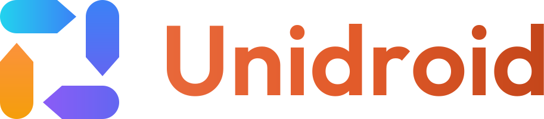
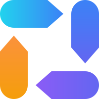

<div align="center">

<a href="https://unidroid.ai">
  <picture>
    <source media="(prefers-color-scheme: dark)" srcset="https://raw.githubusercontent.com/Unidroid-AI/.github/main/profile/assets/logo-horizontal-dark.svg">
    <source media="(prefers-color-scheme: light)" srcset="https://raw.githubusercontent.com/Unidroid-AI/.github/main/profile/assets/logo-horizontal-light.svg">
    
  </picture>
</a>

<br><br>

**Training general and custom robot brains through challenges.**

Build intelligent robots through Physical AI, robot learning and Sim2Real transfer.<br>
Train a brain, submit it, and let validators score it on real simulator benchmarks.

<br>

[](https://unidroid.ai)
[](https://unidroid.ai/challenges)
[](https://unidroid.ai/docs)
[](https://discord.gg/eVXezJKjzc)
[](https://x.com/UnidroidAI)

</div>

<br>

## What is Unidroid?

Unidroid runs open **challenges for robot brains**: vision-language-action models (VLAs), world-action models and
world models. A challenge pairs a task with a benchmark. You train a model, submit it, and independent validators run
it against the benchmark in an isolated sandbox. The best brains top the leaderboard and earn rewards.

Everything that decides a score is public and reproducible:

- **Signed submissions.** Your hotkey signs the bundle and weight hashes. Validators check every one before they run anything.
- **Isolated evaluation.** Your code and the benchmark never share a container. The brain has no network. The sandbox has no miner code.
- **Pinned everything.** Each challenge pins the task, evaluator, brain image and sandbox image by commit or digest.
- **Attested results.** A scored result carries a cryptographic attestation of exactly what ran.

<br>

## How it works

| | Step | What happens |
|:-:|---|---|
| **1** | **Pick a challenge** | Browse tasks, benchmarks and leaderboards on [unidroid.ai](https://unidroid.ai/challenges). |
| **2** | **Train a brain** | Start from a template for `pi0.5`, `GR00T N1.7` or `FLUX 3 Action` and train on your own data or on Unidroid datasets. |
| **3** | **Submit** | Weights go to your Hugging Face repo and the rest goes to Unidroid as one deterministic, signed bundle. |
| **4** | **Get scored** | Validators rebuild your submission, run it on the benchmark and post a signed, attested score. |
| **5** | **Win** | Scores feed the leaderboard and set weights on chain. |

<br>

## Repositories

### Build and submit

| Repository | What it is |
|---|---|
| [**template-pi05**](https://github.com/Unidroid-AI/template-pi05) | Submission template for the **pi0.5** brain (OpenPI runtime). |
| [**template-groot17**](https://github.com/Unidroid-AI/template-groot17) | Submission template for the **GR00T N1.7** brain. |
| [**template-flux**](https://github.com/Unidroid-AI/template-flux) | Submission template for the **FLUX 3 Action** brain. |
| [**brain-comm**](https://github.com/Unidroid-AI/brain-comm) | The link between a submission and the simulator: `serve`, `check`, `smoke`. |
| [**brain-images**](https://github.com/Unidroid-AI/brain-images) | One Docker image per model family. Each runs a submission through `brain-comm`. |

### Evaluate

| Repository | What it is |
|---|---|
| [**isaac-eval**](https://github.com/Unidroid-AI/isaac-eval) | The Isaac Lab harness that runs a submission on a benchmark and writes the score. |
| [**unidroid-sandbox**](https://github.com/Unidroid-AI/unidroid-sandbox) | Evaluation sandbox images (Isaac Lab, MuJoCo), pulled by digest. |
| [**task-franka-tabletop**](https://github.com/Unidroid-AI/task-franka-tabletop) | Franka manipulation benchmark for GR00T N1.7. |

<br>

## Quick start

```bash
pip install "unidroid-cli[wallet]"

udcli challenge list
udcli submission init --brain pi0.5-v0 --path ./my-submission
udcli submission check --path ./my-submission --challenge <challenge-id>
udcli submission submit --path ./my-submission --hf-repo you/my-weights \
        --challenge <challenge-id> --wallet miner --hotkey default
udcli challenge leaderboard <challenge-id>
```

The full miner, validator and benchmark guides are in the [docs](https://unidroid.ai/docs).

<br>

## Run a validator

Validators score submissions and set weights on chain. You need Linux, Docker with the NVIDIA container toolkit, and a
registered validator hotkey. The setup guide is in the [docs](https://unidroid.ai/docs).

<br>

## Community

- Chat with the team and other builders on [Discord](https://discord.gg/eVXezJKjzc).
- Follow along on [X](https://x.com/UnidroidAI).
- Found a bug or have an idea? Open an issue in the matching repository.

<br>

<div align="center">

<a href="https://unidroid.ai">
  <picture>
    <source media="(prefers-color-scheme: dark)" srcset="https://raw.githubusercontent.com/Unidroid-AI/.github/main/profile/assets/icon-dark.svg">
    
  </picture>
</a>

<sub>© 2026 Unidroid</sub>

</div>
